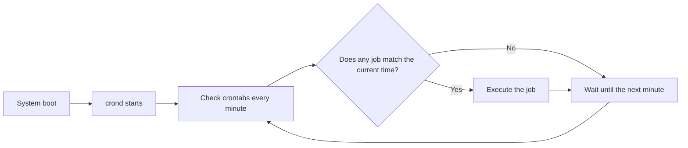

# A Beginner's Guide to Cron

[](https://creativecommons.org/licenses/by-nc-sa/4.0/)


Cron is a time-based job scheduler built into Unix-like operating systems (Linux, macOS, BSD). It lets you automatically run scripts, commands, or programs at specified times and intervals — making it one of the most essential tools for system administrators, developers, and power users alike.


## Table of Contents

- [What is Cron?](#what-is-cron)
- [How Cron Works](#how-cron-works)
- [The Crontab File](#the-crontab-file)
- [Cron Syntax Explained](#cron-syntax-explained)
  - [Field Ranges at a Glance](#field-ranges-at-a-glance)
- [Special Characters](#special-characters)
  - [Asterisk (Wildcard)](#asterisk-wildcard)
  - [Comma (List)](#comma-list)
  - [Hyphen (Range)](#hyphen-range)
  - [Slash (Step)](#slash-step)
  - [Question Mark (No Specific Value)](#question-mark-no-specific-value)
  - [Hash (Comments)](#hash-comments)
- [Practical Examples](#practical-examples)
  - [Every Minute](#every-minute)
  - [Every 5 Minutes](#every-5-minutes)
  - [Every Hour (at :00)](#every-hour-at-00)
  - [Every Day at Midnight](#every-day-at-midnight)
  - [Every Day at 2:30 AM](#every-day-at-230-am)
  - [Every Monday at 8:00 AM](#every-monday-at-800-am)
  - [Every Weekday (Mon–Fri) at 9:00 AM](#every-weekday-monfri-at-900-am)
  - [First Day of Every Month at Midnight](#first-day-of-every-month-at-midnight)
  - [Every 3 Hours](#every-3-hours)
  - [Twice a Day (Noon and Midnight)](#twice-a-day-noon-and-midnight)
  - [Every Sunday at 4:00 AM](#every-sunday-at-400-am)
  - [On January 1st at Midnight (Happy New Year!)](#on-january-1st-at-midnight-happy-new-year)
  - [Every 30 Minutes During Business Hours on Weekdays](#every-30-minutes-during-business-hours-on-weekdays)
- [Cron Shortcuts](#cron-shortcuts)
- [Managing Your Crontab](#managing-your-crontab)
  - [Open Your Crontab for Editing](#open-your-crontab-for-editing)
  - [View Your Current Crontab](#view-your-current-crontab)
  - [Remove Your Crontab](#remove-your-crontab)
  - [Edit Another User's Crontab (as root)](#edit-another-users-crontab-as-root)
  - [List Another User's Crontab (as root)](#list-another-users-crontab-as-root)
  - [Choosing Your Editor](#choosing-your-editor)
- [Environment Variables in Cron](#environment-variables-in-cron)
  - [Setting Variables in Your Crontab](#setting-variables-in-your-crontab)
  - [Key Variables to Know](#key-variables-to-know)
  - [Sourcing Your Profile](#sourcing-your-profile)
- [Logging and Debugging](#logging-and-debugging)
  - [Redirect Output to a Log File](#redirect-output-to-a-log-file)
  - [Separate stdout and stderr](#separate-stdout-and-stderr)
  - [Check the System Cron Log](#check-the-system-cron-log)
  - [Test Your Script Manually First](#test-your-script-manually-first)
  - [Simulate the Cron Environment](#simulate-the-cron-environment)
  - [Add Timestamps to Log Output](#add-timestamps-to-log-output)
- [System-Wide Cron Jobs](#system-wide-cron-jobs)
  - [`/etc/crontab`](#etccrontab)
  - [`/etc/cron.d/`](#etccrond)
  - [The `cron.*` Directories](#the-cron-directories)
- [Common Pitfalls](#common-pitfalls)
- [Security Considerations](#security-considerations)
- [Quick Reference](#quick-reference)
  - [Syntax Template](#syntax-template)
  - [Special Characters Summary](#special-characters-summary)
  - [Crontab Commands](#crontab-commands)
  - [Useful Online Tools](#useful-online-tools)

---
## What is Cron?

The word **cron** comes from the Greek word *chronos* (χρόνος), meaning time. The cron daemon is a background process (on Fedora/RHEL it is cronie's `crond`, systemd service `crond.service`; on Debian/Ubuntu the service is `cron.service`) that wakes up every minute, checks if any scheduled jobs need to run, and executes them.

Cron is ideal for tasks like:

- Running database backups every night
- Sending automated email reports every Monday
- Cleaning up temporary files every hour
- Fetching data from an API on a schedule
- Restarting services after system reboots
- Generating invoices at the end of each month

---


[↑ Back to TOC](#table-of-contents)

## How Cron Works

When your system boots, the cron daemon starts automatically. Every minute it reads a set of configuration files called **crontabs** (cron tables) to check if any jobs are due to run. If a job's schedule matches the current time, cron forks a process to execute it.

The flow looks like this:



---


[↑ Back to TOC](#table-of-contents)

## The Crontab File

A crontab is a plain text file where each line defines one scheduled job. There are two main types:

**User crontabs** — specific to an individual user, edited with `crontab -e`. These jobs run with that user's permissions.

**System crontabs** — located in `/etc/cron.d/`, `/etc/crontab`, and the `/etc/cron.*/` directories. These can specify which user runs the job and are typically managed by root.

---


[↑ Back to TOC](#table-of-contents)

## Cron Syntax Explained

Every cron job entry follows this structure:

```
* * * * *  command to execute
```

The five time fields come first, in this order, followed by the command:

| Position | Field | Allowed values |
|----------|-------|----------------|
| 1 | Minute | 0–59 |
| 2 | Hour | 0–23 |
| 3 | Day of month | 1–31 |
| 4 | Month | 1–12 or JAN–DEC |
| 5 | Day of week | 0–7 or SUN–SAT (0 and 7 are both Sunday) |
| 6+ | Command | The rest of the line, run by `/bin/sh` (or `SHELL`) |

Each field can contain:

| Value | Meaning |
|-------|---------|
| `*` | Any / every value |
| `5` | A specific value |
| `1,3,5` | A list of values |
| `1-5` | A range of values |
| `*/2` | Every 2nd value (step) |
| `1-5/2` | Every 2nd value within a range |


[↑ Back to TOC](#table-of-contents)

### Field Ranges at a Glance

| Field | Allowed Values | Notes |
|-------|---------------|-------|
| Minute | 0–59 | |
| Hour | 0–23 | 0 = midnight |
| Day of Month | 1–31 | |
| Month | 1–12 | Or JAN, FEB, MAR... |
| Day of Week | 0–7 | 0 and 7 both mean Sunday |

> **Important:** If both "day of month" and "day of week" are set (not `*`), the job runs when *either* condition is true, not both.

---


[↑ Back to TOC](#table-of-contents)

## Special Characters


[↑ Back to TOC](#table-of-contents)

### Asterisk (Wildcard)

The asterisk `*` matches every possible value in that field.

```
* * * * * echo "runs every minute"
```


[↑ Back to TOC](#table-of-contents)

### Comma (List)

The comma `,` specifies multiple discrete values.

```
0 9,12,17 * * * /scripts/check.sh
# Runs at 9:00 AM, 12:00 PM, and 5:00 PM every day
```


[↑ Back to TOC](#table-of-contents)

### Hyphen (Range)

The hyphen `-` specifies a continuous range of values.

```
0 9-17 * * 1-5 /scripts/work_hours.sh
# Runs at the top of every hour from 9 AM to 5 PM, Monday through Friday
```


[↑ Back to TOC](#table-of-contents)

### Slash (Step)

The slash `/` specifies intervals. `*/n` means "every n units."

```
*/15 * * * * /scripts/heartbeat.sh
# Runs every 15 minutes

0 */6 * * * /scripts/sync.sh
# Runs every 6 hours (at 00:00, 06:00, 12:00, 18:00)
```


[↑ Back to TOC](#table-of-contents)

### Question Mark (No Specific Value)

The question mark `?` is used in some cron implementations (like Quartz) but **not** standard POSIX cron. Avoid it unless you know your cron supports it.


[↑ Back to TOC](#table-of-contents)

### Hash (Comments)

Any line starting with `#` is a comment and is ignored.

```
# This is a comment — great for documenting your crontab
0 2 * * * /scripts/backup.sh
```

---


[↑ Back to TOC](#table-of-contents)

## Practical Examples


[↑ Back to TOC](#table-of-contents)

### Every Minute
```
* * * * * /scripts/monitor.sh
```


[↑ Back to TOC](#table-of-contents)

### Every 5 Minutes
```
*/5 * * * * /scripts/poll.sh
```


[↑ Back to TOC](#table-of-contents)

### Every Hour (at :00)
```
0 * * * * /scripts/hourly.sh
```


[↑ Back to TOC](#table-of-contents)

### Every Day at Midnight
```
0 0 * * * /scripts/daily_cleanup.sh
```


[↑ Back to TOC](#table-of-contents)

### Every Day at 2:30 AM
```
30 2 * * * /scripts/backup.sh
```


[↑ Back to TOC](#table-of-contents)

### Every Monday at 8:00 AM
```
0 8 * * 1 /scripts/weekly_report.sh
```


[↑ Back to TOC](#table-of-contents)

### Every Weekday (Mon–Fri) at 9:00 AM
```
0 9 * * 1-5 /scripts/standup_reminder.sh
```


[↑ Back to TOC](#table-of-contents)

### First Day of Every Month at Midnight
```
0 0 1 * * /scripts/monthly_invoice.sh
```


[↑ Back to TOC](#table-of-contents)

### Every 3 Hours
```
0 */3 * * * /scripts/sync.sh
```


[↑ Back to TOC](#table-of-contents)

### Twice a Day (Noon and Midnight)
```
0 0,12 * * * /scripts/twice_daily.sh
```


[↑ Back to TOC](#table-of-contents)

### Every Sunday at 4:00 AM
```
0 4 * * 0 /scripts/weekly_maintenance.sh
```


[↑ Back to TOC](#table-of-contents)

### On January 1st at Midnight (Happy New Year!)
```
0 0 1 1 * /scripts/new_year.sh
```


[↑ Back to TOC](#table-of-contents)

### Every 30 Minutes During Business Hours on Weekdays
```
*/30 9-17 * * 1-5 /scripts/check_service.sh
```

---


[↑ Back to TOC](#table-of-contents)

## Cron Shortcuts

Most modern cron implementations support shorthand strings instead of the five-field schedule:

| Shortcut | Equivalent | Meaning |
|----------|------------|---------|
| `@reboot` | — | Run once at startup |
| `@yearly` | `0 0 1 1 *` | Once a year, January 1st |
| `@annually` | `0 0 1 1 *` | Same as @yearly |
| `@monthly` | `0 0 1 * *` | Once a month, first day |
| `@weekly` | `0 0 * * 0` | Once a week, Sunday midnight |
| `@daily` | `0 0 * * *` | Once a day, midnight |
| `@midnight` | `0 0 * * *` | Same as @daily |
| `@hourly` | `0 * * * *` | Once an hour |

Usage examples:

```
@reboot /scripts/start_app.sh
@daily  /scripts/backup.sh
@weekly /scripts/cleanup_logs.sh
```

---


[↑ Back to TOC](#table-of-contents)

## Managing Your Crontab


[↑ Back to TOC](#table-of-contents)

### Open Your Crontab for Editing

```bash
crontab -e
```

This opens your personal crontab in your default editor (usually `nano` or `vi`). Save and exit to install it.


[↑ Back to TOC](#table-of-contents)

### View Your Current Crontab

```bash
crontab -l
```


[↑ Back to TOC](#table-of-contents)

### Remove Your Crontab

```bash
crontab -r
```

> **Warning:** `crontab -r` deletes your entire crontab without confirmation. On Fedora/RHEL (cronie) and Debian/Ubuntu, add `-i` to be asked for a `y/Y` confirmation first: `crontab -ri`. The `-i` option only affects `-r`; it does nothing on its own.


[↑ Back to TOC](#table-of-contents)

### Edit Another User's Crontab (as root)

```bash
sudo crontab -u username -e
```


[↑ Back to TOC](#table-of-contents)

### List Another User's Crontab (as root)

```bash
sudo crontab -u username -l
```


[↑ Back to TOC](#table-of-contents)

### Choosing Your Editor

If you want to change which editor opens with `crontab -e`, set the `EDITOR` or `VISUAL` environment variable:

```bash
export EDITOR=nano
crontab -e
```

---


[↑ Back to TOC](#table-of-contents)

## Environment Variables in Cron

Cron runs in a **very minimal environment** — it doesn't load your shell profile (`.bashrc`, `.zshrc`, etc.), so environment variables you rely on in your terminal may not be available.


[↑ Back to TOC](#table-of-contents)

### Setting Variables in Your Crontab

You can define variables at the top of your crontab file:

```
SHELL=/bin/bash
PATH=/usr/local/sbin:/usr/local/bin:/usr/sbin:/usr/bin:/sbin:/bin
MAILTO=admin@example.com

0 2 * * * /scripts/backup.sh
```


[↑ Back to TOC](#table-of-contents)

### Key Variables to Know

**`SHELL`** — Sets the shell used to execute commands (defaults to `/bin/sh`).

**`PATH`** — Defines where cron looks for executables. This is often the source of "command not found" errors in cron. Always use full paths to be safe:

```
# Instead of:
0 2 * * * python myscript.py

# Use:
0 2 * * * /usr/bin/python3 /home/user/scripts/myscript.py
```

**`MAILTO`** — Sets the email address to receive job output. Set to empty (`MAILTO=""`) to suppress emails entirely.

**`HOME`** — Sets the home directory for the job.


[↑ Back to TOC](#table-of-contents)

### Sourcing Your Profile

If your script needs your full shell environment, source your profile explicitly:

```
0 2 * * * . /home/user/.bashrc && /scripts/my_script.sh
```

Or within the script itself:

```bash
#!/bin/bash
source /home/user/.bashrc
# rest of your script
```

---


[↑ Back to TOC](#table-of-contents)

## Logging and Debugging

Debugging cron jobs can be tricky since they run silently in the background. Here are practical strategies.


[↑ Back to TOC](#table-of-contents)

### Redirect Output to a Log File

```
0 2 * * * /scripts/backup.sh >> /var/log/backup.log 2>&1
```

- `>>` appends stdout to the log file
- `2>&1` redirects stderr to stdout (so errors are also captured)

Use `>` instead of `>>` to overwrite the log each time rather than appending.


[↑ Back to TOC](#table-of-contents)

### Separate stdout and stderr

```
0 2 * * * /scripts/backup.sh >> /var/log/backup.log 2>> /var/log/backup_errors.log
```


[↑ Back to TOC](#table-of-contents)

### Check the System Cron Log

Cron activity is logged to the systemd journal, and to a text log file when rsyslog is installed. The service is called `crond` on Fedora/RHEL and `cron` on Debian/Ubuntu:

```bash
# Fedora/RHEL (cronie): journal, and /var/log/cron if rsyslog is installed (default on RHEL)
journalctl -u crond
sudo grep -i cron /var/log/cron

# Debian/Ubuntu
journalctl -u cron
grep CRON /var/log/syslog
```

Check that the daemon is running with `systemctl status crond` (Debian/Ubuntu: `systemctl status cron`).


[↑ Back to TOC](#table-of-contents)

### Test Your Script Manually First

Always run your script directly from the terminal before scheduling it, using the same user that cron will use:

```bash
bash /path/to/your/script.sh
```


[↑ Back to TOC](#table-of-contents)

### Simulate the Cron Environment

Since cron has a minimal environment, test your script in a similar context:

```bash
env -i HOME=/home/user SHELL=/bin/bash PATH=/usr/bin:/bin /path/to/script.sh
```


[↑ Back to TOC](#table-of-contents)

### Add Timestamps to Log Output

Prepend a timestamp to every log entry so you know exactly when each run occurred:

```
0 2 * * * echo "[$(date '+\%Y-\%m-\%d \%H:\%M:\%S')] Starting backup" >> /var/log/backup.log && /scripts/backup.sh >> /var/log/backup.log 2>&1
```

> **Important:** In a crontab, an unescaped `%` is special: cron turns it into a newline and sends everything after the first `%` to the command as standard input. That cuts the command short, so every `%` in a crontab line must be written as `\%` (as above). Inside a script file, `%` needs no escaping.

Or handle this inside your script (the easier option):

```bash
#!/bin/bash
exec >> /var/log/backup.log 2>&1
echo "[$(date '+%Y-%m-%d %H:%M:%S')] Starting backup..."
# rest of script
```

---


[↑ Back to TOC](#table-of-contents)

## System-Wide Cron Jobs

Beyond user crontabs, Linux systems have several system-level cron locations.


[↑ Back to TOC](#table-of-contents)

### `/etc/crontab`

The main system crontab. It has an extra field for the **username** to run the command as:

```
# ┌────── minute
# │ ┌──── hour
# │ │ ┌── day of month
# │ │ │ ┌ month
# │ │ │ │ ┌ day of week
# │ │ │ │ │ ┌ user
# │ │ │ │ │ │
  0 2 * * * root /scripts/nightly_backup.sh
```


[↑ Back to TOC](#table-of-contents)

### `/etc/cron.d/`

Drop-in files with the same format as `/etc/crontab` (including the user field). These are used by system packages to install their own cron jobs without modifying `/etc/crontab` directly.


[↑ Back to TOC](#table-of-contents)

### The `cron.*` Directories

These directories contain scripts (not crontab files) that are run on a schedule by the system:

| Directory | When scripts run |
|-----------|-----------------|
| `/etc/cron.hourly/` | Every hour |
| `/etc/cron.daily/` | Every day |
| `/etc/cron.weekly/` | Every week |
| `/etc/cron.monthly/` | Every month |

To use these, place an executable script in the appropriate directory — no crontab syntax required.

```bash
sudo cp my_backup.sh /etc/cron.daily/my_backup
sudo chmod +x /etc/cron.daily/my_backup
```

> **Note:** On Debian/Ubuntu, `run-parts` skips any file whose name contains a dot, so `my_backup.sh` would never run. Fedora/RHEL's `run-parts` only skips backup-style names (ending in `~` or `,`, or `.rpmsave`, `.rpmnew`, `.swp` and similar), but leaving off the extension works everywhere.
>
> On Fedora/RHEL, `/etc/cron.hourly/` is run by `/etc/cron.d/0hourly`, and the daily, weekly and monthly directories are run by `anacron` (see `/etc/anacrontab`), with a random delay, so the exact start time varies.

---


[↑ Back to TOC](#table-of-contents)

## Common Pitfalls

**Using relative paths.** Cron doesn't know your current working directory. Always use absolute paths for both the command and any files it references.

**Forgetting the PATH.** Commands like `python`, `node`, `git`, or even `grep` may not be found. Use full paths (`/usr/bin/python3`) or set `PATH` at the top of your crontab.

**Script not executable.** Your script must have execute permissions: `chmod +x /path/to/script.sh`.

**Missing newline at end of file.** Some cron implementations require a newline after the last entry. Always end your crontab with a blank line.

**Forgetting to redirect output.** By default, cron emails you the output of every job. If email isn't configured, output is silently lost. Always redirect to a log file or suppress with `> /dev/null 2>&1`.

**Off-by-one in day of week.** Both `0` and `7` represent Sunday. Monday is `1`. Don't assume `0` is Monday.

**Timezone confusion.** Cron uses the system timezone. If you're in the cloud or working across timezones, confirm the server's timezone with `timedatectl` or `date`.

**Overlapping jobs.** If a job takes longer than its interval, multiple instances can pile up. Use a lock file or tools like `flock` to prevent this:

```
*/5 * * * * flock -n /tmp/myjob.lock /scripts/myjob.sh
```

**Unescaped `%` signs.** A `%` in the command part of a crontab line becomes a newline. Write `date +\%F` instead of `date +%F`, or move the command into a script.

**Editing the crontab directly.** Never edit the spool file directly (`/var/spool/cron/username` on Fedora/RHEL, `/var/spool/cron/crontabs/username` on Debian/Ubuntu). Always use `crontab -e`, which validates the file before installing it.

---


[↑ Back to TOC](#table-of-contents)

## Security Considerations

**Principle of least privilege.** Run cron jobs as the least privileged user that can accomplish the task. Avoid running everything as root.

**Protect your scripts.** Make sure scripts called by cron are only writable by their owner:

```bash
chmod 700 /path/to/script.sh
```

**Use `/etc/cron.allow` and `/etc/cron.deny`.** These files control which users can use cron. If `cron.allow` exists, only listed users can create crontabs. If only `cron.deny` exists, listed users are blocked.

**Review crontabs regularly.** Check for unauthorized or unexpected entries, especially on multi-user systems:

```bash
# List all user crontabs
for user in $(cut -f1 -d: /etc/passwd); do
  echo "=== $user ==="; crontab -u "$user" -l 2>/dev/null
done
```

**Be careful with `MAILTO`.** If set, job output is emailed — potentially leaking sensitive information. Always redirect output to a log file and set `MAILTO=""` if email isn't needed.

---


[↑ Back to TOC](#table-of-contents)

## Quick Reference


[↑ Back to TOC](#table-of-contents)

### Syntax Template

```
MIN HOUR DOM MON DOW command
```

| Field | Name | Allowed values |
|-------|------|----------------|
| `MIN` | Minute | 0–59 |
| `HOUR` | Hour | 0–23 |
| `DOM` | Day of month | 1–31 |
| `MON` | Month | 1–12 or JAN–DEC |
| `DOW` | Day of week | 0–7 or SUN–SAT (Sunday = 0 or 7) |


[↑ Back to TOC](#table-of-contents)

### Special Characters Summary

| Character | Meaning | Example |
|-----------|---------|---------|
| `*` | Every value | `* * * * *` — every minute |
| `,` | List | `1,15,30` — at minutes 1, 15, and 30 |
| `-` | Range | `1-5` — values 1 through 5 |
| `/` | Step | `*/10` — every 10 units |


[↑ Back to TOC](#table-of-contents)

### Crontab Commands

| Command | Action |
|---------|--------|
| `crontab -e` | Edit your crontab |
| `crontab -l` | List your crontab |
| `crontab -r` | Remove your crontab |
| `crontab -u user -e` | Edit another user's crontab (root only) |


[↑ Back to TOC](#table-of-contents)

### Useful Online Tools

- **crontab.guru** — An interactive cron expression editor and explainer. Paste any cron expression and see a plain-English description.
- **cronitor.io** — Cron job monitoring with alerts.
- **cron-job.org** — Free cloud-based cron service for web endpoints.

---

*Happy scheduling! Cron is simple on the surface but incredibly powerful once you get comfortable with the syntax. When in doubt, use [crontab.guru](https://crontab.guru) to verify your expressions before deploying them.*

[↑ Back to TOC](#table-of-contents)

---

© 2026 Jaco Steyn — Licensed under [CC BY-NC-SA 4.0](https://creativecommons.org/licenses/by-nc-sa/4.0/)
