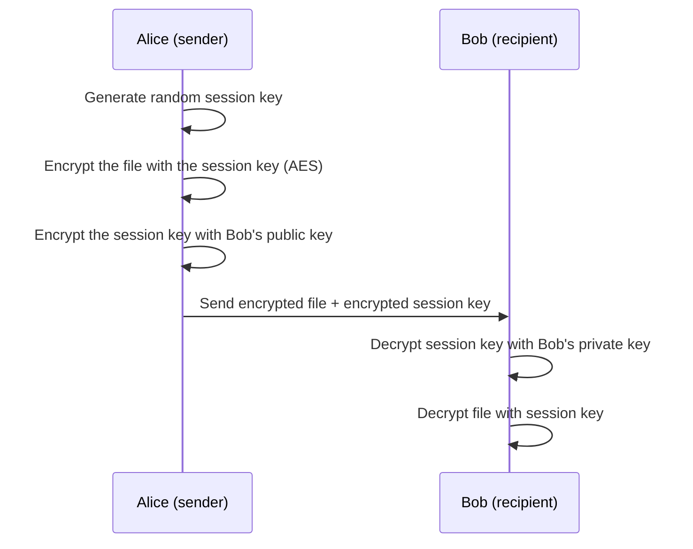
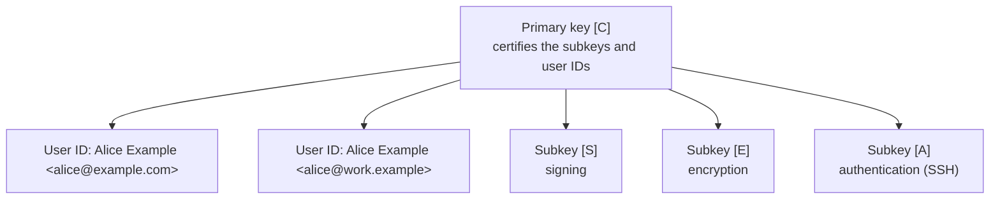
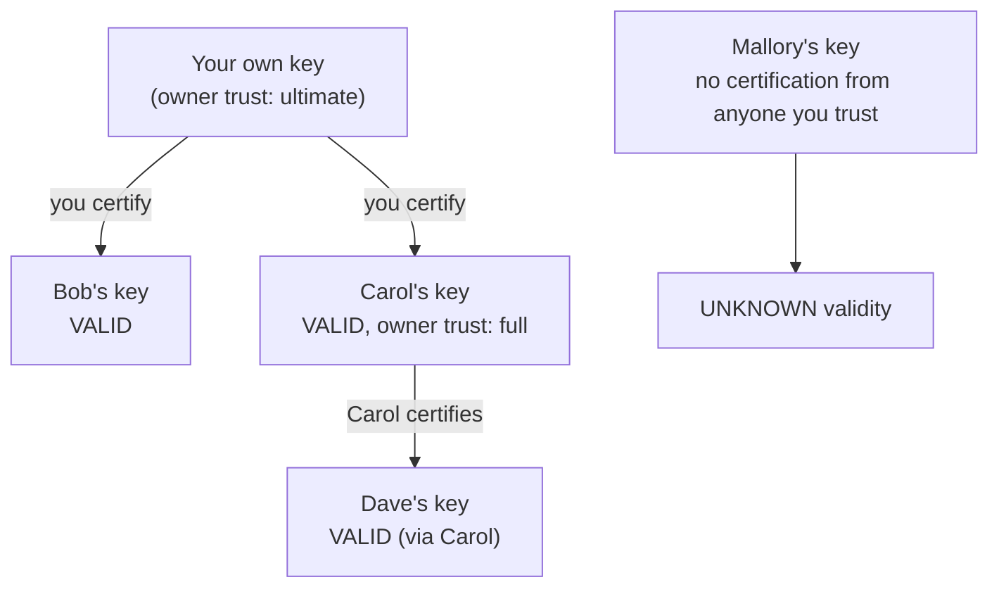
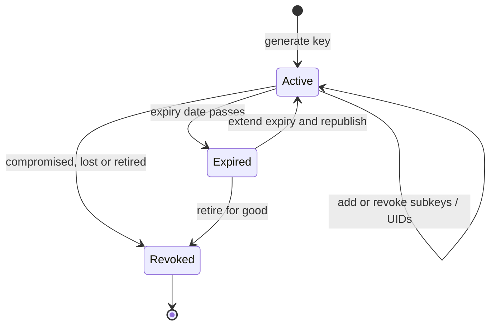

# OpenPGP User Guide: Encryption, Signing and Key Management with GnuPG

[](https://creativecommons.org/licenses/by-nc-sa/4.0/)
[](https://gnupg.org/)
[](https://www.openpgp.org/)

A practical guide to OpenPGP using GnuPG (`gpg`) on Linux. It explains what OpenPGP is, how to encrypt, sign and verify, and how to manage your keys over their whole life: creating them, backing them up, extending them, moving them to a hardware key, and revoking them. Examples use Fedora/RHEL, but the `gpg` commands work the same on any system.

## Table of Contents

- [What is OpenPGP?](#what-is-openpgp)
  - [OpenPGP vs PGP vs GnuPG](#openpgp-vs-pgp-vs-gnupg)
  - [What you can do with it](#what-you-can-do-with-it)
- [Core Concepts](#core-concepts)
  - [Public and private keys](#public-and-private-keys)
  - [How encryption works (hybrid encryption)](#how-encryption-works-hybrid-encryption)
  - [How signatures work](#how-signatures-work)
  - [Primary keys, subkeys and capabilities](#primary-keys-subkeys-and-capabilities)
  - [User IDs, fingerprints and key IDs](#user-ids-fingerprints-and-key-ids)
- [Installing and Configuring GnuPG](#installing-and-configuring-gnupg)
  - [Installing](#installing)
  - [The GnuPG home directory](#the-gnupg-home-directory)
  - [Recommended configuration](#recommended-configuration)
- [Creating Your Key](#creating-your-key)
  - [Choosing algorithms and expiry](#choosing-algorithms-and-expiry)
  - [Quick start: one command](#quick-start-one-command)
  - [Recommended: certify-only primary with subkeys](#recommended-certify-only-primary-with-subkeys)
  - [Choosing a passphrase](#choosing-a-passphrase)
- [Listing and Inspecting Keys](#listing-and-inspecting-keys)
  - [Reading the output](#reading-the-output)
- [Encrypting and Decrypting](#encrypting-and-decrypting)
  - [Encrypting for someone](#encrypting-for-someone)
  - [Decrypting](#decrypting)
  - [Symmetric encryption (passphrase only)](#symmetric-encryption-passphrase-only)
- [Signing and Verifying](#signing-and-verifying)
  - [Three kinds of signature](#three-kinds-of-signature)
  - [Signing and encrypting together](#signing-and-encrypting-together)
  - [Verifying a downloaded file](#verifying-a-downloaded-file)
  - [Reading verification output](#reading-verification-output)
- [Exchanging Public Keys](#exchanging-public-keys)
  - [Exporting and importing](#exporting-and-importing)
  - [Keyservers](#keyservers)
  - [Web Key Directory (WKD)](#web-key-directory-wkd)
  - [Checking fingerprints out of band](#checking-fingerprints-out-of-band)
- [Trust and the Web of Trust](#trust-and-the-web-of-trust)
  - [Validity vs owner trust](#validity-vs-owner-trust)
  - [Certifying (signing) someone's key](#certifying-signing-someones-key)
  - [Setting owner trust](#setting-owner-trust)
  - [TOFU: an alternative trust model](#tofu-an-alternative-trust-model)
- [Key Management Lifecycle](#key-management-lifecycle)
  - [Editing user IDs and the passphrase](#editing-user-ids-and-the-passphrase)
  - [Expiry: setting and extending](#expiry-setting-and-extending)
  - [Backing up your keys](#backing-up-your-keys)
  - [Keeping the primary key offline](#keeping-the-primary-key-offline)
  - [Revocation](#revocation)
  - [Moving to a new machine](#moving-to-a-new-machine)
  - [Replacing a key](#replacing-a-key)
  - [Deleting keys](#deleting-keys)
- [The gpg-agent](#the-gpg-agent)
- [Integrations](#integrations)
  - [Git commit and tag signing](#git-commit-and-tag-signing)
  - [SSH with gpg-agent](#ssh-with-gpg-agent)
  - [YubiKeys and smartcards](#yubikeys-and-smartcards)
  - [Email with Thunderbird](#email-with-thunderbird)
  - [The pass password manager](#the-pass-password-manager)
- [Security Best Practices](#security-best-practices)
- [Common Mistakes](#common-mistakes)
- [Troubleshooting](#troubleshooting)
- [Quick Reference](#quick-reference)
- [Next Steps](#next-steps)

---

## What is OpenPGP?

OpenPGP is an open standard for **encrypting** and **digitally signing** data with public-key cryptography. It lets you:

- send a file or message that only the intended person can read,
- prove that a file or message came from you and was not changed, and
- check that software you downloaded really came from its developers.

OpenPGP does not need a central authority. You create your own keys, and you decide whose keys to trust.

### OpenPGP vs PGP vs GnuPG

| Name | What it is |
|------|------------|
| **PGP** ("Pretty Good Privacy") | The original program, written by Phil Zimmermann in 1991. It is now a commercial product. |
| **OpenPGP** | The open standard based on PGP. It was published as RFC 4880 (2007), then updated as RFC 9580 (2024). |
| **GnuPG** (GNU Privacy Guard, `gpg`) | The free, most widely used implementation of OpenPGP. It is installed by default on most Linux distributions. |

When people say "PGP key", "GPG key" or "OpenPGP key", they almost always mean the same thing.

> **Note on standards:** GnuPG 2.4 follows the *LibrePGP* draft (which defines v5 keys) and does not implement RFC 9580's v6 keys. Normal keys (v4, which is what `gpg` creates by default) work with every OpenPGP program. You only need to care about this if you deliberately create newer key versions.

### What you can do with it

- **Encrypt files** for yourself (backups) or for others.
- **Sign files and releases** so others can check where they came from.
- **Verify** downloads, ISO images and packages (`dnf` checks package signatures with OpenPGP keys).
- **Sign Git commits and tags.**
- **Log in over SSH** with an OpenPGP authentication key.
- **Encrypt and sign email.**
- **Store passwords** in an encrypted password store (`pass`).

---

[↑ Back to TOC](#table-of-contents)

## Core Concepts

### Public and private keys

Every OpenPGP key has two halves:

- **Public key**: share it with everyone. Others use it to encrypt data for you and to check your signatures.
- **Private (secret) key**: keep it to yourself, protected by a passphrase. You use it to decrypt data sent to you and to make signatures.

What is encrypted with your public key can only be decrypted with your private key. What is signed with your private key can be checked by anyone who has your public key.

### How encryption works (hybrid encryption)

Public-key cryptography is slow, so OpenPGP uses it only for a small, random **session key**. The data itself is encrypted with that session key using a fast symmetric cipher (such as AES). The session key is then encrypted with each recipient's public key and attached to the message.



This is why one encrypted file can have several recipients: the data is encrypted once, and the session key is encrypted once for each recipient.

### How signatures work

To sign, `gpg` calculates a hash (a fingerprint of the data, such as SHA-256) and signs that hash with your private key. To verify, the other person calculates the same hash and checks it against your signature using your public key. If one byte of the data changed, the check fails.

A signature proves two things: the data was not changed (**integrity**), and it was made by the holder of the private key (**authenticity**). It does **not** keep the data secret.

### Primary keys, subkeys and capabilities

An OpenPGP "key" is really a bundle, called a **certificate**. It contains a **primary key**, one or more **subkeys**, and one or more **user IDs**.



Each key has one or more **capabilities**:

| Flag | Capability | Used for |
|------|------------|----------|
| `C` | Certify | Signing other keys and its own subkeys and user IDs. Only the primary key has this. |
| `S` | Sign | Signing files, messages and Git commits. |
| `E` | Encrypt | Receiving encrypted data. |
| `A` | Authenticate | Logging in, for example over SSH. |

Why subkeys matter: your **primary key is your identity**. Other people's trust and signatures attach to it. Subkeys do the day-to-day work and can be replaced without losing that identity. If a subkey is lost or stolen, you revoke just that subkey and create a new one. This is the basis of the [offline primary key](#keeping-the-primary-key-offline) setup.

### User IDs, fingerprints and key IDs

- **User ID (UID)**: a name and email address, such as `Alice Example <alice@example.com>`. A key can have several.
- **Fingerprint**: a 40-character hex hash of the public key, such as `3F2A 9C0B 7E1D 4A5F 6B8C  9D0E 1F2A 3B4C 5D6E 7F80`. This is how you identify a key reliably.
- **Key ID**: the last 16 hex characters of the fingerprint (*long ID*, `1F2A3B4C5D6E7F80`), or the last 8 (*short ID*, `5D6E7F80`).

> **Warning:** never rely on short key IDs. Attackers can easily create fake keys with the same short ID. Always compare the **full fingerprint**.

---

[↑ Back to TOC](#table-of-contents)

## Installing and Configuring GnuPG

### Installing

GnuPG is usually already installed. Check with:

```bash
gpg --version
```

If it is missing:

```bash
# Fedora / RHEL / Rocky / Alma
sudo dnf install gnupg2 pinentry

# Debian / Ubuntu
sudo apt install gnupg pinentry-curses

# macOS (Homebrew)
brew install gnupg pinentry-mac
```

`pinentry` is the small program that asks for your passphrase. There are terminal (`pinentry-curses`, `pinentry-tty`) and desktop versions (`pinentry-gnome3`, `pinentry-qt`).

### The GnuPG home directory

All of your keys and settings live in `~/.gnupg/`:

```text
~/.gnupg/
├── gpg.conf               # options for gpg
├── gpg-agent.conf         # options for the agent (passphrase cache, pinentry, SSH)
├── dirmngr.conf           # keyserver settings
├── pubring.kbx            # your public keyring
├── trustdb.gpg            # owner-trust database
├── private-keys-v1.d/     # your private keys, one file per key (named by keygrip)
├── openpgp-revocs.d/      # revocation certificates created with your keys
└── sshcontrol             # keys gpg-agent may use for SSH
```

The directory must be private to you:

```bash
chmod 700 ~/.gnupg
chmod 600 ~/.gnupg/*.conf
```

You can use a different directory for testing with `--homedir` or the `GNUPGHOME` variable. This is a safe way to experiment without touching your real keys:

```bash
export GNUPGHOME=$(mktemp -d)
# ... experiment ...
gpgconf --kill gpg-agent
rm -rf "$GNUPGHOME"; unset GNUPGHOME
```

### Recommended configuration

GnuPG's modern defaults are good, so you need very little. A useful `~/.gnupg/gpg.conf`:

```text
# Show long key IDs and full fingerprints
keyid-format 0xlong
with-fingerprint
with-subkey-fingerprint

# Show how valid each user ID is
list-options show-uid-validity
verify-options show-uid-validity

# Encrypt to yourself too, so you can read what you send (use your fingerprint)
# encrypt-to 3F2A9C0B7E1D4A5F6B8C9D0E1F2A3B4C5D6E7F80
```

A useful `~/.gnupg/gpg-agent.conf`:

```text
# How long (seconds) the passphrase stays cached after use, and at most
default-cache-ttl 600
max-cache-ttl 7200

# Optional: force a terminal pinentry
# pinentry-program /usr/bin/pinentry-curses
```

A `~/.gnupg/dirmngr.conf` that sets the keyserver:

```text
keyserver hkps://keys.openpgp.org
```

After changing `gpg-agent.conf` or `dirmngr.conf`, reload them:

```bash
gpgconf --reload gpg-agent
gpgconf --kill dirmngr
```

> **Avoid old "hardening" guides** that set long lists of `personal-cipher-preferences`, `cert-digest-algo` and so on. They were written for GnuPG 1.x. Today's defaults are already strong, and copied settings can cause interoperability problems.

---

[↑ Back to TOC](#table-of-contents)

## Creating Your Key

### Choosing algorithms and expiry

| Choice | Recommendation |
|--------|----------------|
| Algorithm | **ed25519** for signing/certify and **cv25519** for encryption (the default in GnuPG 2.4). Fast, small and secure. Use **RSA 4096** only if you need compatibility with very old software or hardware. |
| Primary key expiry | **1–3 years.** You can extend it at any time before (or even after) it expires. |
| Subkey expiry | **1 year** is a common choice. |
| Passphrase | Always use one. See [Choosing a passphrase](#choosing-a-passphrase). |

**Why set an expiry?** Expiry is a safety net. If you lose your private key *and* your revocation certificate, the key still stops being usable on its own. Extending it is a 10-second job, so expiry costs you almost nothing.

### Quick start: one command

If you just want a working key:

```bash
gpg --quick-generate-key "Alice Example <alice@example.com>" default default 2y
```

This creates an ed25519 primary key (Sign + Certify) that expires in two years, and a cv25519 encryption subkey. `gpg` asks for a passphrase.

The encryption subkey created this way has **no expiry**. Give it one too (use your fingerprint, see step 2 below):

```bash
gpg --quick-set-expire "$FPR" 2y '*'
```

For an interactive walkthrough with all options:

```bash
gpg --full-generate-key
```

### Recommended: certify-only primary with subkeys

For long-term use, a better layout is a primary key that **only certifies**, plus separate subkeys for signing, encryption and authentication. You can then keep the primary key offline (see [Keeping the primary key offline](#keeping-the-primary-key-offline)).

**Step 1: create the primary key (certify only):**

```bash
gpg --quick-generate-key "Alice Example <alice@example.com>" ed25519 cert 3y
```

**Step 2: save the fingerprint in a variable** (it is the 40-character value shown under `pub`):

```bash
gpg --list-keys alice@example.com
export FPR=3F2A9C0B7E1D4A5F6B8C9D0E1F2A3B4C5D6E7F80

# Or let gpg fill it in for you:
export FPR=$(gpg --list-keys --with-colons alice@example.com | awk -F: '/^fpr/{print $10; exit}')
```

The rest of this guide uses `"$FPR"` wherever your fingerprint is needed.

**Step 3: add the subkeys:**

```bash
gpg --quick-add-key "$FPR" ed25519 sign 1y
gpg --quick-add-key "$FPR" cv25519 encr 1y
gpg --quick-add-key "$FPR" ed25519 auth 1y   # optional, for SSH
```

That's it. You now have one identity with three working subkeys.

### Choosing a passphrase

Your passphrase protects the private key files on disk. If someone copies `~/.gnupg`, the passphrase is all that stands between them and your key.

- Use a **long passphrase** of 5–7 random words (a *diceware* passphrase), such as `copper-glacier-tunnel-orbit-mango-fable`.
- Don't reuse a password from somewhere else.
- Store it in your password manager, or write it down and keep it with your offline backup.
- Change it with `gpg --change-passphrase "$FPR"`.

---

[↑ Back to TOC](#table-of-contents)

## Listing and Inspecting Keys

```bash
gpg --list-keys                       # all public keys (short: gpg -k)
gpg --list-secret-keys                # keys you have the private part of (gpg -K)
gpg --list-keys alice@example.com     # search by email, name or fingerprint
gpg --fingerprint alice@example.com   # show the fingerprint in readable groups
gpg --list-secret-keys --with-keygrip # also show keygrips (needed for SSH and some file operations)
```

### Reading the output

```text
$ gpg --list-secret-keys alice@example.com
sec   ed25519/0x1F2A3B4C5D6E7F80 2026-11-21 [C] [expires: 2029-11-20]
      Key fingerprint = 3F2A 9C0B 7E1D 4A5F 6B8C  9D0E 1F2A 3B4C 5D6E 7F80
uid                   [ultimate] Alice Example <alice@example.com>
ssb   ed25519/0x8A1B2C3D4E5F6071 2026-11-21 [S] [expires: 2027-11-21]
      Key fingerprint = 7D2E 1C0B 9A88 7766 5544  3322 8A1B 2C3D 4E5F 6071
ssb   cv25519/0x9B2C3D4E5F607182 2026-11-21 [E] [expires: 2027-11-21]
      Key fingerprint = E4F5 0617 2839 4A5B 6C7D  8E9F 9B2C 3D4E 5F60 7182
ssb   ed25519/0xAC3D4E5F60718293 2026-11-21 [A] [expires: 2027-11-21]
      Key fingerprint = 0A1B 2C3D 4E5F 6071 8293  A4B5 AC3D 4E5F 6071 8293
```

This is the layout with the [recommended `gpg.conf`](#recommended-configuration). Without it, `gpg` shows the fingerprint as one unbroken 40-character line under `sec` and leaves out the key IDs and subkey fingerprints.

| Part | Meaning |
|------|---------|
| `pub` / `sec` | Primary key: public / with secret part available |
| `sub` / `ssb` | Subkey: public / with secret part available |
| `sec#` / `ssb#` | The secret part is **not** here (for example, the primary key is offline) |
| `sec>` / `ssb>` | The secret part is on a **smartcard** (such as a YubiKey) |
| `ed25519`, `cv25519`, `rsa4096` | The algorithm |
| `0x1F2A3B4C5D6E7F80` | The long key ID |
| `[C]`, `[S]`, `[E]`, `[A]` | Capabilities |
| `[ultimate]`, `[  full  ]`, `[ unknown]` | How valid `gpg` thinks this user ID is (see [Trust](#trust-and-the-web-of-trust)). Listings pad the shorter words with spaces. |
| `[expired]`, `[revoked]` | The key or subkey can no longer be used |

---

[↑ Back to TOC](#table-of-contents)

## Encrypting and Decrypting

### Encrypting for someone

You need the recipient's public key in your keyring (see [Exchanging Public Keys](#exchanging-public-keys)).

```bash
# Binary output: creates report.pdf.gpg
gpg --encrypt --recipient bob@example.com report.pdf

# ASCII ("armored") output, safe to paste into email or chat: creates notes.txt.asc
gpg --encrypt --armor --recipient bob@example.com notes.txt

# Several recipients, and yourself, so you can still read it later
gpg -e -r bob@example.com -r carol@example.com -r alice@example.com plan.odt

# Choose the output file name
gpg -e -r bob@example.com -o backup.tar.gpg backup.tar

# Encrypt from a pipe
tar czf - ~/Documents | gpg -e -r alice@example.com -o documents.tar.gz.gpg
```

Short options: `-e` encrypt, `-r` recipient, `-a` armor, `-o` output, `-s` sign, `-d` decrypt, `-c` symmetric.

> **Tip:** if you always want to be able to read what you encrypt, add `encrypt-to <your fingerprint>` to `gpg.conf` instead of adding yourself with `-r` every time.

### Decrypting

```bash
gpg --decrypt notes.txt.asc                 # prints to the terminal
gpg --decrypt -o notes.txt notes.txt.asc    # writes to a file
gpg documents.tar.gz.gpg                    # guesses the output name (documents.tar.gz)
gpg -d documents.tar.gz.gpg | tar xzf -     # decrypt straight into tar
```

`gpg` finds the right private key automatically and asks for your passphrase through pinentry.

### Symmetric encryption (passphrase only)

When you don't need keys at all, for example to protect a file on a USB stick, encrypt with just a passphrase:

```bash
gpg --symmetric --armor secrets.txt     # creates secrets.txt.asc
gpg -d secrets.txt.asc                   # asks for the passphrase
```

Anyone with the passphrase can decrypt it, so choose a strong one and share it through a separate channel.

---

[↑ Back to TOC](#table-of-contents)

## Signing and Verifying

### Three kinds of signature

| Type | Command | Result | Use it for |
|------|---------|--------|------------|
| **Detached** | `gpg --detach-sign --armor file.tar.gz` | `file.tar.gz.asc` (separate signature file) | Software releases, ISOs, any file you don't want to change |
| **Clear-signed** | `gpg --clearsign message.txt` | `message.txt.asc` (readable text with the signature wrapped around it) | Emails, announcements, checksum files |
| **Inline** | `gpg --sign file` | `file.gpg` (compressed, signed, not human-readable) | Rarely used today |

Verify each type with `gpg --verify`:

```bash
gpg --verify file.tar.gz.asc file.tar.gz   # detached: signature first, then the data
gpg --verify message.txt.asc               # clear-signed
gpg --decrypt file.gpg > file              # inline: verifies and extracts the content
```

If you have more than one signing key, choose one with `--local-user` (`-u`):

```bash
gpg -u alice@work.example --detach-sign report.pdf
```

### Signing and encrypting together

Sign *and* encrypt so the recipient knows the message is from you and nobody else can read it:

```bash
gpg --sign --encrypt --armor -r bob@example.com message.txt
```

When Bob decrypts it, `gpg` also checks and reports the signature.

### Verifying a downloaded file

Many projects publish a checksum file plus a signature. The usual steps:

```bash
# 1. Get the project's public key, then CHECK ITS FINGERPRINT against the
#    project's website or documentation (see "Checking fingerprints out of band")
gpg --recv-keys <fingerprint published by the project>

# 2. Verify the signature on the checksum file
gpg --verify SHA256SUMS.asc SHA256SUMS

# 3. Check the download against the verified checksums
sha256sum --check --ignore-missing SHA256SUMS
```

If the project signs the file directly, verify that instead: `gpg --verify project-1.2.tar.gz.asc project-1.2.tar.gz`.

To verify against a single key file, without adding it to your keyring, use `gpgv`. The key file must be a **binary** export (`gpg --export FPR > key.gpg`), not an armored `.asc` file:

```bash
gpgv --keyring ./project-signing-key.gpg SHA256SUMS.asc SHA256SUMS
```

### Reading verification output

A good result:

```text
gpg: Signature made <date and time>
gpg:                using EDDSA key 7D2E1C0B9A887766554433228A1B2C3D4E5F6071
gpg: Good signature from "Alice Example <alice@example.com>" [full]
```

A good result from a key you haven't certified:

```text
gpg: Good signature from "Project Release Key <release@project.example>" [unknown]
gpg: WARNING: This key is not certified with a trusted signature!
gpg:          There is no indication that the signature belongs to the owner.
Primary key fingerprint: 3F2A 9C0B 7E1D 4A5F 6B8C  9D0E 1F2A 3B4C 5D6E 7F80
```

This warning means: *the signature is mathematically correct, but `gpg` doesn't know whether this key really belongs to that person.* Compare the printed fingerprint with the one the project publishes. If they match, the file is genuine. To make the warning go away, [certify the key](#certifying-signing-someones-key).

A bad result:

```text
gpg: BAD signature from "Alice Example <alice@example.com>" [full]
```

**Never use a file with a BAD signature.** It was changed or corrupted after it was signed.

---

[↑ Back to TOC](#table-of-contents)

## Exchanging Public Keys

### Exporting and importing

```bash
# Export your public key to a file you can share
gpg --export --armor alice@example.com > alice-public.asc

# Export only the newest self-signatures, without third-party signatures (smaller)
gpg --export --armor --export-options export-minimal alice@example.com > alice-minimal.asc

# Import someone's key
gpg --import bob-public.asc
```

Your **public** key is safe to publish anywhere: your website, email signature, GitHub profile.

> **Warning:** `--export-secret-keys` exports your **private** key. Only use it for backups. Never send its output to anyone.

### Keyservers

Keyservers are public directories of OpenPGP keys.

```bash
# Upload your key
gpg --keyserver hkps://keys.openpgp.org --send-keys "$FPR"

# Download a key by fingerprint
gpg --keyserver hkps://keys.openpgp.org --recv-keys 3F2A9C0B7E1D4A5F6B8C9D0E1F2A3B4C5D6E7F80

# Search by email
gpg --keyserver hkps://keys.openpgp.org --search-keys bob@example.com

# Update all keys in your keyring (new expiry dates, revocations)
gpg --refresh-keys
```

If you set the keyserver in `dirmngr.conf` (see [Recommended configuration](#recommended-configuration)), you can leave out `--keyserver`.

About **keys.openpgp.org**:

- It only publishes a user ID (name and email) after you confirm it by email. `gpg --send-keys` does **not** start this: after your first upload, go to <https://keys.openpgp.org/upload> (or `/manage`) to request the verification email. Alternatively, upload with `gpg --export "$FPR" | curl -T - https://keys.openpgp.org` and open the link it prints.
- Until a user ID is verified, the key is served without it, so other people can't import it as a new key. They can only receive updates (new expiry dates, revocations) for a copy they already have.
- It removes third-party signatures, so it doesn't carry the Web of Trust. Exchange signed keys directly instead.
- It is the recommended keyserver. The older "SKS" network was shut down in 2021 after abuse.

### Web Key Directory (WKD)

WKD lets an email domain publish its users' keys over HTTPS, so others can find a key just from an email address. Many providers (such as Proton Mail and posteo) and projects (such as kernel.org) use it.

```bash
# Look up a key via WKD (and other configured methods)
gpg --locate-external-keys bob@example.com
```

If you run your own domain, `gpg-wks-client` (Fedora package `gnupg2-wks`) can create the WKD files for you to put on your web server.

### Checking fingerprints out of band

Downloading a key proves nothing on its own: anyone can create a key with any name and email. Before you trust a key, compare its **full fingerprint** through a separate, trusted channel:

- in person, from a printed card or screen,
- over a phone or video call where you recognise the person,
- on an HTTPS website the person or project controls, or
- in signed documentation you already trust.

```bash
gpg --fingerprint bob@example.com
```

---

[↑ Back to TOC](#table-of-contents)

## Trust and the Web of Trust

### Validity vs owner trust

Two ideas are easy to mix up:

- **Validity:** *"Does this key really belong to the person named in it?"* `gpg` shows it in brackets next to each user ID: `[ultimate]`, `[full]`, `[marginal]`, `[unknown]`.
- **Owner trust:** *"How much do I trust this person to check other people's keys carefully before they certify them?"* You set it yourself, and it is never published.

A key becomes valid when it is certified by enough keys you trust:



By default, a key is valid if it is certified by **your own key**, by **one key with full owner trust**, or by **three keys with marginal owner trust**.

### Certifying (signing) someone's key

After you have checked the fingerprint, certify the key:

```bash
# Exportable certification: others can see that you vouch for this key
gpg --sign-key bob@example.com

# Local certification: only you can see it (most people want this)
gpg --lsign-key bob@example.com
```

`--lsign-key` is the right choice for everyday use. It marks the key as valid for you without publishing anything. Use `--sign-key` only when you have met the person, checked their ID, and want to vouch for them in public. Then send them their signed key so they can publish it:

```bash
gpg --export --armor bob@example.com > bob-signed-by-alice.asc
```

### Setting owner trust

```bash
gpg --edit-key bob@example.com
gpg> trust
  1 = I don't know or won't say
  2 = I do NOT trust
  3 = I trust marginally
  4 = I trust fully
  5 = I trust ultimately
Your decision? 3
gpg> quit
```

Only give **ultimate** trust to your **own** keys. `gpg` sets this automatically when you create a key.

### TOFU: an alternative trust model

For many people the Web of Trust is too much work. **TOFU** (Trust On First Use) works like SSH's `known_hosts`: `gpg` remembers which key it first saw for each email address and warns you if a different key shows up later.

Add this to `gpg.conf` to combine TOFU with the classic model:

```text
trust-model tofu+pgp
```

---

[↑ Back to TOC](#table-of-contents)

## Key Management Lifecycle

Keys are not "set and forget". They have a life: you create them, use them, extend them, back them up, and one day revoke or replace them.



### Editing user IDs and the passphrase

```bash
# Add an email address
gpg --quick-add-uid "$FPR" "Alice Example <alice@work.example>"

# Make a user ID the primary one (shown first)
gpg --quick-set-primary-uid "$FPR" "Alice Example <alice@example.com>"

# Revoke a user ID you no longer use (for example, an old job email)
gpg --quick-revoke-uid "$FPR" "Alice Example <alice@oldjob.example>"

# Change the passphrase
gpg --change-passphrase "$FPR"
```

User IDs that were ever published can't really be deleted: other people's copies keep them. **Revoke** them instead, so everyone learns they are no longer valid. After any change, [publish your updated key](#keyservers) again.

The interactive editor can do all of this and more:

```bash
gpg --edit-key "$FPR"
gpg> help
```

### Expiry: setting and extending

Extend your key **before** it expires (set a calendar reminder about a month ahead):

```bash
# Extend the primary key by 2 years from today
gpg --quick-set-expire "$FPR" 2y

# Extend ALL subkeys by 1 year
gpg --quick-set-expire "$FPR" 1y '*'

# Extend one subkey (by its fingerprint)
gpg --quick-set-expire "$FPR" 1y 7D2E1C0B9A887766554433228A1B2C3D4E5F6071

# Remove the expiry (not recommended)
gpg --quick-set-expire "$FPR" 0
```

Then publish the updated key, and send it to people who use it, so their copy stops showing it as expired:

```bash
gpg --send-keys "$FPR"
```

An expired key isn't broken. Extend it, publish it, and everyone who refreshes your key can use it again.

### Backing up your keys

If you lose your private key, you can't decrypt anything that was encrypted to it. **Make a backup as soon as you create a key**, and again after every change.

```bash
# Private key (primary + subkeys) - KEEP THIS SAFE
gpg --export-secret-keys --armor "$FPR" > alice-secret.asc

# Private subkeys only (no primary) - see "Keeping the primary key offline"
gpg --export-secret-subkeys --armor "$FPR" > alice-secret-subkeys.asc

# Public key
gpg --export --armor "$FPR" > alice-public.asc

# Your owner-trust settings
gpg --export-ownertrust > ownertrust.txt

# The revocation certificate gpg created for you
cp ~/.gnupg/openpgp-revocs.d/"$FPR".rev .
```

Where to keep the backup:

- On **two** encrypted USB sticks (for example LUKS-encrypted), stored in different places.
- **Not** in plain cloud storage. If you must, encrypt it first with `gpg --symmetric` and a strong passphrase.
- Optionally, on **paper**. `paperkey` prints only the secret parts, which is much shorter than the full key:

```bash
sudo dnf install paperkey
gpg --export-secret-keys "$FPR" | paperkey --output alice-paperkey.txt

# Restore later (you also need the public key)
paperkey --pubring alice-public.gpg --secrets alice-paperkey.txt | gpg --import
```

For the `paperkey` restore, `alice-public.gpg` is the binary export: `gpg --export "$FPR" > alice-public.gpg`.

**Test your backup** by importing it into a temporary home directory:

```bash
export GNUPGHOME=$(mktemp -d)
gpg --import alice-secret.asc
gpg --list-secret-keys
gpgconf --kill gpg-agent; rm -rf "$GNUPGHOME"; unset GNUPGHOME
```

### Keeping the primary key offline

The primary key is only needed to **certify**: add or revoke subkeys and user IDs, change expiry, and sign other people's keys. Day-to-day signing, encryption and SSH use subkeys only. So you can keep the primary secret key **off** your everyday computer. If the computer is compromised, the attacker only gets subkeys, which you can revoke and replace while keeping your identity.

**1. Make a full backup first** (see [Backing up your keys](#backing-up-your-keys)) and check that it works. The next step deletes the primary secret key from this machine.

**2. Find the primary key's keygrip:**

```bash
gpg --list-secret-keys --with-keygrip "$FPR"
```

The `Keygrip = ...` line directly under `sec` belongs to the primary key.

**3. Delete only the primary secret key:**

```bash
gpg --delete-secret-keys "$FPR!"
```

The `!` at the end means "only this exact key, not its subkeys". Confirm the prompts. (Alternatively, delete `~/.gnupg/private-keys-v1.d/<primary-keygrip>.key`.)

**4. Check the result:** the primary key now shows `sec#`:

```text
sec#  ed25519/0x1F2A3B4C5D6E7F80 2026-11-21 [C] [expires: 2029-11-20]
      Key fingerprint = 3F2A 9C0B 7E1D 4A5F 6B8C  9D0E 1F2A 3B4C 5D6E 7F80
uid                   [ultimate] Alice Example <alice@example.com>
ssb   ed25519/0x8A1B2C3D4E5F6071 2026-11-21 [S] [expires: 2027-11-21]
ssb   cv25519/0x9B2C3D4E5F607182 2026-11-21 [E] [expires: 2027-11-21]
ssb   ed25519/0xAC3D4E5F60718293 2026-11-21 [A] [expires: 2027-11-21]
```

(Subkey fingerprint lines are left out here for brevity.)

Signing and decrypting still work. Certifying doesn't.

**When you need the primary key** (to extend expiry, add a subkey or sign someone's key), use the backup in a temporary home directory, ideally on an offline machine or a live USB system:

```bash
export GNUPGHOME=$(mktemp -d)
gpg --import alice-secret.asc
gpg --quick-set-expire "$FPR" 1y '*'
gpg --export --armor "$FPR" > alice-public-updated.asc
gpgconf --kill gpg-agent; rm -rf "$GNUPGHOME"; unset GNUPGHOME

# Back on your daily machine: import the updated PUBLIC key
gpg --import alice-public-updated.asc
```

Importing the public key brings in the new expiry dates without bringing the primary secret back. Remember to update your offline backup too.

### Revocation

A **revocation certificate** announces "this key must no longer be used". Revoke when:

- your private key was stolen or may have been copied,
- you lost the private key or forgot the passphrase, or
- you are replacing the key and want to retire the old one.

**The auto-generated certificate.** When you create a key, `gpg` saves a revocation certificate in `~/.gnupg/openpgp-revocs.d/<fingerprint>.rev`. Copy it to your backup. It is your safety net if you lose the private key.

**Creating one with a specific reason:**

```bash
gpg --output alice-revoke.asc --generate-revocation "$FPR"
```

`gpg` asks for a reason (compromised, superseded, no longer used) and an optional comment.

> **Keep revocation certificates secret.** Anyone who has one can revoke your key. They can't impersonate you with it, but they can make your key useless.

**Using a revocation certificate:**

```bash
# For the auto-generated file: open it in a text editor and remove the ':' at the
# start of the "-----BEGIN PGP PUBLIC KEY BLOCK-----" line. Then:
gpg --import ~/.gnupg/openpgp-revocs.d/"$FPR".rev

# Publish the revoked key so everyone learns about it
gpg --send-keys "$FPR"
```

**Revoking a single subkey** (needs the primary secret key):

```bash
gpg --edit-key "$FPR"
gpg> key 1          # select the subkey (marked with *)
gpg> revkey         # revoke it, then choose a reason
gpg> save
gpg --send-keys "$FPR"
```

Then add a new subkey with `--quick-add-key` and publish again.

### Moving to a new machine

**Option 1: export and import** (cleanest):

```bash
# Old machine
gpg --export-secret-keys --armor "$FPR" > secret.asc
gpg --export-ownertrust > ownertrust.txt
gpg --export --armor > all-public-keys.asc      # everyone else's keys too

# Copy the files over a safe channel (USB stick, scp), then on the new machine:
gpg --import all-public-keys.asc
gpg --import secret.asc
gpg --import-ownertrust ownertrust.txt

# Delete the copies afterwards
shred -u secret.asc
```

**Option 2: copy the whole directory.** Stop the agent first (`gpgconf --kill all`), then copy `~/.gnupg` with permissions intact (`rsync -a` or `tar`). Set `chmod 700 ~/.gnupg` on the new machine.

If your keys are on a YubiKey, see "Using the card on a new machine" in [YubiKeys and smartcards](#yubikeys-and-smartcards).

### Replacing a key

Sometimes you need a fresh key: you want a new algorithm, or the old key was compromised.

1. Create the new key and back it up.
2. If the old key is **not** compromised, sign the new key with the old one, so people who trust the old key can trust the new one:

   ```bash
   gpg -u OLD_FINGERPRINT --sign-key NEW_FINGERPRINT
   ```

3. Optionally write a short transition statement ("my new key is ...") and clear-sign it with **both** keys.
4. Publish the new key, and update Git hosting, email and `pass` (see [Integrations](#integrations)).
5. Revoke the old key with the reason "superseded", and publish it.

Keep the old **private** key in your backup: you still need it to decrypt old data encrypted to it.

### Deleting keys

```bash
gpg --delete-keys bob@example.com          # someone else's public key
gpg --delete-secret-keys "$FPR"            # your private key (asks for confirmation)
gpg --delete-secret-and-public-keys "$FPR" # both
```

Deleting your own key from your keyring does **not** remove it from keyservers or other people's keyrings. To retire a published key, [revoke it](#revocation).

---

[↑ Back to TOC](#table-of-contents)

## The gpg-agent

`gpg-agent` runs in the background. It holds your unlocked private keys, caches passphrases, talks to smartcards and can act as an SSH agent. `gpg` starts it automatically.

```bash
gpgconf --kill gpg-agent              # stop it (it restarts when needed)
gpgconf --reload gpg-agent            # reload gpg-agent.conf
gpg-connect-agent reloadagent /bye    # same as --reload; both clear cached passphrases
gpgconf --list-dirs                   # show socket paths and directories
```

**Passphrase cache:** `default-cache-ttl` (seconds since last use) and `max-cache-ttl` (absolute maximum) in `gpg-agent.conf` control how long you stay unlocked.

**Terminal use:** pinentry needs to know which terminal to use. Add this to `~/.bashrc`:

```bash
export GPG_TTY=$(tty)
```

**Over SSH:** if pinentry opens on the wrong screen (or not at all), tell the agent to use the current terminal:

```bash
gpg-connect-agent updatestartuptty /bye
```

**Scripts and automation:** for unattended use, the agent can accept the passphrase directly with `--pinentry-mode loopback --passphrase-file <file>`. Keep such files private, and prefer a dedicated key without the power to certify.

---

[↑ Back to TOC](#table-of-contents)

## Integrations

### Git commit and tag signing

Signed commits and tags prove that they came from you. GitHub and GitLab show them as **Verified**.

**1. Tell Git which key to use:**

```bash
git config --global user.signingkey 3F2A9C0B7E1D4A5F6B8C9D0E1F2A3B4C5D6E7F80
git config --global commit.gpgsign true    # sign every commit
git config --global tag.gpgSign true       # sign every annotated tag
```

Git uses your signing subkey automatically. The **email in `git config user.email` must match a user ID** in your key, or GitHub won't show "Verified".

**2. Sign and check:**

```bash
git commit -S -m "Add feature"     # -S signs one commit (not needed with commit.gpgsign)
git tag -s v1.0 -m "Release 1.0"   # signed tag
git log --show-signature -1        # show the signature of the last commit
git verify-commit HEAD
git verify-tag v1.0
```

**3. Add your public key to GitHub:**

```bash
gpg --export --armor "$FPR"
```

Copy the output, including the `BEGIN` and `END` lines, into **GitHub → Settings → SSH and GPG keys → New GPG key**. The email in the key must also be a verified email on your GitHub account. When you extend or change the key, upload it again.

If signing fails with `gpg failed to sign the data`, test with `echo test | gpg --clearsign`. The usual fix is `export GPG_TTY=$(tty)` (see [Troubleshooting](#troubleshooting)).

### SSH with gpg-agent

You can use an authentication subkey `[A]` as your SSH key. This is most useful with a YubiKey: the SSH key then never leaves the hardware. (For SSH basics, see the [SSH Beginner's Guide](ssh-beginners-guide.md) and [SSH Keys & Management](SSH%20Keys%20%26%20Management%20%E2%80%93%20Practical%20Beginners%20Guide.md).)

**1. Create an authentication subkey** if you don't have one:

```bash
gpg --quick-add-key "$FPR" ed25519 auth 1y
```

**2. Enable SSH support** in `~/.gnupg/gpg-agent.conf`:

```text
enable-ssh-support
```

**3. Point SSH at gpg-agent** in `~/.bashrc`:

```bash
export GPG_TTY=$(tty)
export SSH_AUTH_SOCK=$(gpgconf --list-dirs agent-ssh-socket)
gpg-connect-agent updatestartuptty /bye >/dev/null
```

**4. Allow the key:** find the keygrip of the `[A]` subkey and add it to `~/.gnupg/sshcontrol`. Keys on a smartcard are available automatically and need no entry.

```bash
gpg --list-secret-keys --with-keygrip "$FPR"
echo "<keygrip of the [A] subkey>" >> ~/.gnupg/sshcontrol
gpgconf --kill gpg-agent
```

**5. Check it and get the public key for servers:**

```bash
ssh-add -L                          # should list your key
gpg --export-ssh-key "$FPR" > ~/.ssh/id_gpg.pub
ssh-copy-id -f -i ~/.ssh/id_gpg.pub user@server
```

> **Fedora/GNOME note:** the desktop may start its own SSH agent and set `SSH_AUTH_SOCK`. Setting `SSH_AUTH_SOCK` in `~/.bashrc` (as above) overrides it in your terminals.

### YubiKeys and smartcards

An OpenPGP smartcard (such as a YubiKey, Nitrokey or OpenPGP Card) stores your subkeys in tamper-resistant hardware. The keys **can't be copied off the card**: signing and decryption happen on the card itself, after you enter a PIN. See the [Beginners Guide to YubiKeys](Beginners%20Guide%20to%20YubiKeys.md) for background.

**Prepare the system (Fedora):**

```bash
sudo dnf install gnupg2-scdaemon pcsc-lite pcsc-lite-ccid yubikey-manager
sudo systemctl enable --now pcscd.socket
gpg --card-status
```

If `gpg --card-status` says "No such device" or "Card not present" while `pcscd` is running, the two are fighting over the card. Tell GnuPG's `scdaemon` to share it through `pcscd`. Create `~/.gnupg/scdaemon.conf`:

```text
disable-ccid
pcsc-shared
```

Then run `gpgconf --kill scdaemon` and try again.

**Set the PINs.** A new card has the default **User PIN `123456`** and **Admin PIN `12345678`**. Change both:

```bash
gpg --card-edit
gpg/card> admin
gpg/card> kdf-setup     # optional: store PINs as hashes; do this BEFORE changing PINs or adding keys
gpg/card> passwd        # 1 = change PIN, 3 = change Admin PIN
gpg/card> name          # optional: cardholder name
gpg/card> quit
```

Three wrong User PINs block the User PIN. Unblock it with the Admin PIN (`gpg --card-edit`, `admin`, `passwd`, option 2), or with a Reset Code if you set one. Three wrong Admin PINs block the Admin PIN: the keys keep working with the User PIN, but you can no longer change settings, move keys or unblock the User PIN. The only way out is a factory reset (`ykman openpgp reset` on a YubiKey), which erases the keys on the card.

**Move your subkeys to the card.**

> **Warning:** `keytocard` *moves* the key. After `save`, the local copy is replaced by a pointer to the card. **Make and test a full backup first**, or the key only exists on that one card.

```bash
gpg --edit-key "$FPR"
gpg> key 1          # select the signing subkey
gpg> keytocard      # choose (1) Signature key
gpg> key 1          # deselect it
gpg> key 2          # select the encryption subkey
gpg> keytocard      # choose (2) Encryption key
gpg> key 2
gpg> key 3          # select the authentication subkey
gpg> keytocard      # choose (3) Authentication key
gpg> save
```

`gpg --list-secret-keys` now shows `ssb>` for those subkeys. To put the same keys on a **second (backup) card**, restore your backup into a temporary home directory and run `keytocard` again with the second card.

**Require a touch** for every operation, so malware can't use the key silently:

```bash
ykman openpgp keys set-touch sig on
ykman openpgp keys set-touch enc on
ykman openpgp keys set-touch aut on
```

**Using the card on a new machine:** the card stores only the private keys. The new machine also needs your public key:

```bash
gpg --import alice-public.asc     # or: gpg --recv-keys "$FPR"
gpg --card-status                 # links the keys to the card (creates the "ssb>" stubs)
```

You can store your public key's URL on the card (`gpg/card> admin`, `url`), and then use `fetch` in `gpg --card-edit` on a new machine to download it.

### Email with Thunderbird

Thunderbird has OpenPGP built in (it no longer needs the Enigmail add-on). It uses its own key store, not `~/.gnupg`.

**Use your existing key:**

1. Export it: `gpg --export-secret-keys --armor "$FPR" > for-thunderbird.asc`.
2. In Thunderbird: **Account Settings → End-To-End Encryption → Add Key → Import an existing OpenPGP Key**, and choose the file.
3. Delete the export afterwards: `shred -u for-thunderbird.asc`.

**Use a key on a YubiKey (external GnuPG):** because the private key can't be imported, tell Thunderbird to use GnuPG for it:

1. **Settings → General → Config Editor**, set `mail.openpgp.allow_external_gnupg` to `true`.
2. In **End-To-End Encryption → Add Key**, choose **Use your external key through GnuPG** and enter your key ID.
3. Import your **public** key into Thunderbird's OpenPGP Key Manager as well, so it can attach and use it.

**Good to know:**

- Recipients' public keys go into Thunderbird's **OpenPGP Key Manager**. It can look them up via WKD and keys.openpgp.org.
- OpenPGP itself does not protect email headers. Thunderbird encrypts the **subject** of encrypted messages by default (you can turn this off), but the sender, recipients and dates always stay visible.
- **Autocrypt** is a related standard some mail apps use to exchange keys automatically in email headers.

### The pass password manager

[`pass`](https://www.passwordstore.org/) stores each password in its own small file, encrypted with your OpenPGP key. It is simple, scriptable, and can sync with Git. (The Podman `pass` secret driver uses the same store: see the [Podman Secrets Guide](podman_secrets_guide.md).)

```bash
sudo dnf install pass

# Create the store, encrypted to your key (uses your encryption subkey)
pass init 3F2A9C0B7E1D4A5F6B8C9D0E1F2A3B4C5D6E7F80

pass insert email/work            # add a password (asks for it)
pass generate web/github 24       # generate a random 24-character password
pass show email/work              # show it
pass -c email/work                # copy to the clipboard (cleared after 45 seconds)
pass                              # list everything
pass edit web/github              # edit with $EDITOR (add usernames, notes)
pass rm web/old-site
```

**Sync with Git** (use a private repository; the files are encrypted, but their names are not):

```bash
pass git init
pass git remote add origin git@github.com:youruser/password-store.git
pass git push -u origin HEAD
```

After this, `pass` commits every change automatically. Run `pass git pull` and `pass git push` to sync.

**Changing keys:** if you replace your encryption key, run `pass init <new fingerprint>` and `pass` re-encrypts every entry for the new key.

---

[↑ Back to TOC](#table-of-contents)

## Security Best Practices

- **Use a passphrase** on every private key.
- **Set an expiry** on keys and subkeys, and extend it every year or two.
- **Back up** your private key and revocation certificate offline, in two places, and test the backup.
- **Use subkeys** for daily work, and keep the primary key offline if you can.
- **Use a hardware key** (YubiKey or similar) for subkeys if you rely on OpenPGP heavily.
- **Check full fingerprints** through a separate channel before you trust a key.
- **Refresh keys** regularly (`gpg --refresh-keys`) so you learn about revocations and new expiry dates.
- **Keep GnuPG updated** through your package manager.
- **Encrypt to yourself** too (`encrypt-to` in `gpg.conf`), or you can't read your own sent messages.
- **Remember the limits:** OpenPGP protects content, not metadata. Who you talk to, when, and email subjects may still be visible.

---

[↑ Back to TOC](#table-of-contents)

## Common Mistakes

| Mistake | Why it's a problem | Do this instead |
|---------|--------------------|-----------------|
| Trusting short (8-character) key IDs | Fake keys with the same short ID are easy to make | Compare the full 40-character fingerprint |
| Trusting a key because it is on a keyserver | Anyone can upload a key with any name | Check the fingerprint out of band |
| No backup of the private key | Lose the laptop, lose everything encrypted to you | Back up offline as soon as you create the key |
| No revocation certificate saved | You can't revoke a lost key | Copy `openpgp-revocs.d/*.rev` to your backup |
| Key without expiry and no backup | A lost key stays "valid" forever | Always set an expiry |
| Sending `--export-secret-keys` output to someone | You've given away your private key | Share only `gpg --export --armor` output |
| `keytocard` without a backup | The key exists only on one card | Back up and test before moving keys to a card |
| Forgetting to republish after changes | Others still see the key as expired | `gpg --send-keys` after every change |
| Deleting an old key you replaced | You can't decrypt old data any more | Revoke it, but keep the private key in your backup |

---

[↑ Back to TOC](#table-of-contents)

## Troubleshooting

| Error or symptom | Likely cause | Fix |
|------------------|--------------|-----|
| `gpg: signing failed: Inappropriate ioctl for device` | pinentry doesn't know which terminal to use | `export GPG_TTY=$(tty)` (add it to `~/.bashrc`) |
| `gpg: decryption failed: No secret key` | The data was encrypted to a key you don't have, or the card isn't plugged in | Run `gpg --list-packets --pinentry-mode cancel file.gpg` to see which key ID it was encrypted to |
| `gpg: <key>: skipped: Unusable public key` | The recipient's key is expired or revoked, or has no encryption subkey | `gpg --refresh-keys`, or ask them for an updated key |
| `gpg: WARNING: unsafe permissions on homedir` | `~/.gnupg` is readable by others | `find ~/.gnupg -type d -exec chmod 700 {} +` and `find ~/.gnupg -type f -exec chmod 600 {} +` |
| `No pinentry` / passphrase prompt never shows | pinentry not installed, or wrong program | `sudo dnf install pinentry`, check `pinentry-program` in `gpg-agent.conf`, then `gpgconf --kill gpg-agent` |
| Prompt appears in another terminal or on the desktop | The agent is attached to an old terminal | `gpg-connect-agent updatestartuptty /bye` |
| `gpg: keyserver receive failed: No data` | The key isn't on that keyserver, or its UID hasn't been verified | Try WKD (`--locate-external-keys`) or ask for the key file |
| `gpg --card-status`: `Card not present` | `pcscd` and `scdaemon` conflict, or the card isn't detected | Add `disable-ccid` and `pcsc-shared` to `scdaemon.conf`, `gpgconf --kill scdaemon` |
| Git: `error: gpg failed to sign the data` | Any of the above | Run `echo test \| gpg --clearsign` to see the real error |
| Anything else odd | A stuck agent | `gpgconf --kill all` and try again |

For more detail, add `-v` (or `-vv`) to the `gpg` command. `gpg --list-packets --pinentry-mode cancel file.gpg` shows what is inside an encrypted or signed file (such as which key it was encrypted to) without asking for your passphrase.

---

[↑ Back to TOC](#table-of-contents)

## Quick Reference

| Command | Description |
|---------|-------------|
| `gpg --quick-generate-key "Name <email>" default default 2y` | Create a key |
| `gpg --full-generate-key` | Create a key interactively |
| `gpg --quick-add-key FPR ed25519 sign 1y` | Add a signing subkey (`cv25519 encr`, `ed25519 auth` for others) |
| `gpg -k` / `gpg -K` | List public / secret keys |
| `gpg --fingerprint EMAIL` | Show a key's fingerprint |
| `gpg -e -r EMAIL file` | Encrypt for a recipient |
| `gpg -e -a -r EMAIL file` | Encrypt with ASCII-armored output |
| `gpg -c file` | Encrypt with a passphrase only |
| `gpg -d file.gpg` | Decrypt |
| `gpg --detach-sign -a file` | Create a detached signature (`file.asc`) |
| `gpg --clearsign file` | Create a clear-signed text |
| `gpg --verify file.asc file` | Verify a detached signature |
| `gpg --export -a EMAIL` | Export a public key |
| `gpg --import file.asc` | Import a key |
| `gpg --send-keys FPR` / `--recv-keys FPR` | Upload / download a key from a keyserver |
| `gpg --locate-external-keys EMAIL` | Find a key via WKD |
| `gpg --refresh-keys` | Update all keys from the keyserver |
| `gpg --lsign-key EMAIL` | Certify a key locally |
| `gpg --edit-key FPR` | Interactive key editor |
| `gpg --quick-add-uid FPR "Name <email>"` | Add a user ID |
| `gpg --quick-set-expire FPR 2y` | Extend the primary key |
| `gpg --quick-set-expire FPR 1y '*'` | Extend all subkeys |
| `gpg --export-secret-keys -a FPR` | Back up the private key |
| `gpg --generate-revocation FPR` | Create a revocation certificate |
| `gpg --delete-secret-keys "FPR!"` | Delete only the primary secret key |
| `gpg --card-status` / `--card-edit` | Show / manage a smartcard |
| `gpg --export-ssh-key FPR` | Show the SSH public key of the `[A]` subkey |
| `gpgconf --kill gpg-agent` | Restart the agent |

---

[↑ Back to TOC](#table-of-contents)

## Next Steps

- **[The GnuPG manual](https://www.gnupg.org/documentation/manuals/gnupg/)**: the full reference for every option.
- **[RFC 9580](https://www.rfc-editor.org/rfc/rfc9580)**: the current OpenPGP standard, if you want the details.
- **[keys.openpgp.org](https://keys.openpgp.org/about)**: how the recommended keyserver works.
- **[drduh's YubiKey Guide](https://github.com/drduh/YubiKey-Guide)**: a very thorough walkthrough of an offline primary key with YubiKeys.
- **[The pass website](https://www.passwordstore.org/)**: extensions, apps for phones and browsers.
- Related guides in this collection: [Beginners Guide to YubiKeys](Beginners%20Guide%20to%20YubiKeys.md), [SSH Beginner's Guide](ssh-beginners-guide.md), [Podman Secrets Guide](podman_secrets_guide.md).

Start small: create a key, back it up, sign a Git commit and encrypt a file for yourself. Once that feels normal, move your subkeys to a hardware key and put the primary key offline.

[↑ Back to TOC](#table-of-contents)

---

© 2026 Jaco Steyn — Licensed under [CC BY-NC-SA 4.0](https://creativecommons.org/licenses/by-nc-sa/4.0/)
